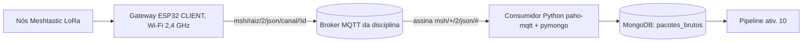

# Atividade 9: Gateway no ar (consumidor MQTT -> MongoDB)

Projeto Integrador de Big Data (IAL220), **Fatec Pompeia**. Professor: **Allan Siriani** ([github.com/siriani](https://github.com/siriani)). Aluno: Jonah Nishimura Kunihiro.

Uma rede LoRa em malha (Meshtastic) cobre o campus e a cidade de Pompeia. Um gateway ESP32 com o módulo MQTT publica os pacotes, em JSON, no broker da disciplina. Este repositório contém o **consumidor** que assina esse ramo JSON e grava **cada mensagem, sem transformação**, na coleção `pacotes_brutos` do MongoDB, mais a documentação do gateway, da segurança e do diário.

## Arquitetura


## Contrato do documento
```
{ topico: str, recebido_em: datetime (UTC), mensagem: <JSON original, inalterado> }
{ topico: str, recebido_em: datetime (UTC), mensagem_raw: <texto> }   # payload que não é JSON válido
```
Nada é descartado nem deduplicado aqui (duplicatas `from`+`id` de gateways diferentes são esperadas; a deduplicação é do pipeline). Índices (não únicos): `recebido_em` e `(mensagem.from, mensagem.id)`.

## Estrutura
```
consumidor/   código (app, núcleo de tratamento, configuração)
consultas/    contagem_por_no_48h.js (mongosh) e .py
ferramentas/  simulador.py (SÓ TESTE LOCAL)
tests/        pytest (sem broker nem Mongo reais)
docs/         configuracao_gateway, seguranca, diario_de_bordo, entrega_whatsapp
```

## Configuração
Copie `.env.example` para `.env` e preencha (broker, usuário **só de leitura**, Mongo). O `.env` nunca é versionado. Variáveis: `MQTT_HOST`, `MQTT_PORT`, `MQTT_USER`, `MQTT_PASSWORD`, `MQTT_TLS`, `MQTT_TOPIC` (padrão `msh/+/2/json/#`), `MQTT_CLIENT_ID`, `MONGO_URI`, `MONGO_DB`, `MONGO_COLLECTION` (padrão `pacotes_brutos`); opcionais `LOG_DIR`, `LOG_LEVEL`, `HEARTBEAT_SEGUNDOS`, `BUFFER_MAX`.

## Rodar local (Windows/PowerShell)
```powershell
python -m venv .venv
.\.venv\Scripts\Activate.ps1
pip install -r requirements.txt
python -m consumidor
```
Ctrl+C encerra de forma limpa. Logs em `logs/consumidor.log` (rotativo, 5 x 5 MB) e no terminal; a cada `HEARTBEAT_SEGUNDOS` aparece uma linha `HEARTBEAT` com recebidas/gravadas/falhas/buffer.

## Rodar em Docker
```
docker build -t consumidor-pacotes-brutos .
docker run -d --name consumidor --restart unless-stopped --env-file .env -v "$(pwd)/logs:/app/logs" consumidor-pacotes-brutos
docker logs -f consumidor
```
(No Windows PowerShell use `${PWD}` no lugar de `$(pwd)`.) Atenção: se o Mongo estiver no mesmo host, `localhost` dentro do contêiner não é o host; use o IP/nome do servidor.

## Manter ativo por 48h
- **Docker**: `--restart unless-stopped` (acima). O Docker precisa iniciar com o servidor.
- **systemd** (Linux): serviço com `Restart=always`, `EnvironmentFile=/caminho/.env`, `ExecStart=/caminho/.venv/bin/python -m consumidor`, `WorkingDirectory` no projeto.
- **nohup** (simples): `nohup .venv/bin/python -m consumidor > /dev/null 2>&1 &` (o log vai para `logs/`).
- Em notebook pessoal, desative a suspensão do Windows durante as 48h; prefira um servidor.
- Registre início, fim, local e interrupções em `docs/diario_de_bordo.md`.

Robustez implementada: reconexão automática ao broker (backoff 1 a 60 s) e re-subscribe a cada conexão; sessão MQTT persistente (QoS 1, `clean_session=False`) para reduzir perdas em quedas curtas; o driver do Mongo reconecta sozinho, e se o banco cair as mensagens vão para um buffer em memória limitado (`BUFFER_MAX`) reenviado em ordem na volta (se estourar, descarta a mais antiga e conta em `descartadas`); índices recriados se falharem na partida.

Limitação: o buffer fica em memória; se o processo for morto durante uma queda do Mongo, esse buffer se perde.

## Consultas
```
mongosh "<MONGO_URI>/<MONGO_DB>" consultas/contagem_por_no_48h.js
python consultas/contagem_por_no_48h.py --horas 48
```
Mostram, por nó (`mensagem.from`, ou `sender` se faltar), o total, os pacotes diretos (`hops_away` = 0), os **ouvidos por salto** (`hops_away` > 0) e os sem a informação.

## Testes
```powershell
pip install -r requirements-dev.txt
python -m pytest -q
```
Usam `mongomock` e chamam o tratamento de mensagens diretamente.

## Simulador (SOMENTE TESTE LOCAL)
`ferramentas/simulador.py` publica pacotes **falsos** em um broker **local** (recusa hosts remotos sem flag explícita). **Seus dados NÃO servem como evidência de entrega**: evidência forjada zera a nota. Nunca o aponte para o broker da disciplina.

## Documentação
- [docs/configuracao_gateway.md](docs/configuracao_gateway.md)
- [docs/seguranca.md](docs/seguranca.md)
- [docs/diario_de_bordo.md](docs/diario_de_bordo.md)
- [docs/entrega_whatsapp.md](docs/entrega_whatsapp.md)
